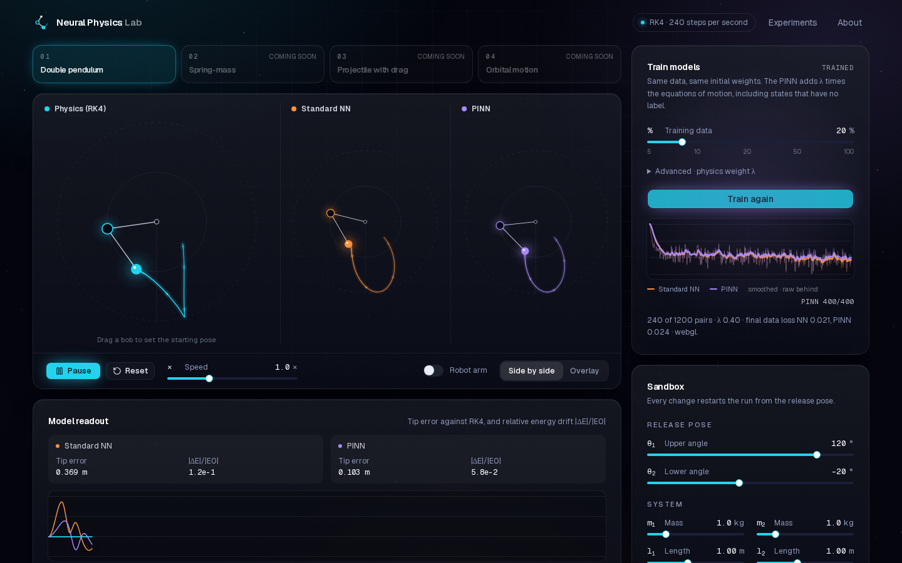

[](https://github.com/Yelzhan-1/neural-physics-lab/actions/workflows/ci.yml)

# Neural Physics Lab

**Live:** [neural-physics-lab-roan.vercel.app](https://neural-physics-lab-roan.vercel.app)

Does a network predict a double pendulum better when the equations of motion are in its loss, especially when the recorded data is scarce? Two identical networks train in the browser, roll out next to an RK4 solver, and the comparison is the number you can recompute with `pnpm experiments`.


Scan that code, or open [/qr](https://neural-physics-lab-roan.vercel.app/qr). It points at the live site above.



## Results

Seed 2026, 1300 optimizer steps, batch 64, cosine learning rate 1e-3 → 1e-4, λ 0.4. Generated 2026-11-26T17:35:25.586Z on TensorFlow CPU in 143 s. MSE is the mean squared state error (Δθ in radians, Δω in rad/s). Energy drift is relative, |E(T) − E(0)| / |E(0)|. The winner is the lower rollout MSE.

| Experiment | Setting | Horizon | NN MSE | PINN MSE | NN \|ΔE\|/\|E0\| | PINN \|ΔE\|/\|E0\| | Winner |
| --- | --- | ---: | ---: | ---: | ---: | ---: | --- |
| Standard conditions | 100% data, held-out trajectories | 2 s | 4.111 | 1.679 | 0.544 | 0.195 | PINN |
| Limited training data | 5% | 2 s | 50.051 | 8.227 | 17.097 | 1.797 | PINN |
| Limited training data | 10% | 2 s | 7.475 | 5.175 | 0.469 | 0.388 | PINN |
| Unseen initial conditions | train small angles, test large | 2 s | 11.153 | 7.382 | 0.277 | 0.377 | PINN |
| Long-term prediction | full data | 1 s | 1.474 | 0.678 | 0.222 | 0.148 | PINN |
| Long-term prediction | full data | 3 s | 10.388 | 2.596 | 0.798 | 0.170 | PINN |
| Long-term prediction | full data | 10 s | 19.972 | 7.610 | 0.774 | 0.520 | PINN |

On this seed the PINN has the lower rollout MSE everywhere. It does not win energy drift on the unseen-angle run: there the standard NN drifts less (0.277 against 0.377).

Same budget on seeds 2026, 7 and 42, mean ± sample standard deviation:

| Run | NN MSE | PINN MSE | NN \|ΔE\|/\|E0\| | PINN \|ΔE\|/\|E0\| |
| --- | --- | --- | --- | --- |
| E1, full data | 2.946 ± 1.189 | 2.397 ± 0.682 | 0.377 ± 0.213 | 0.211 ± 0.032 |
| E2, 5% of the data | 19.077 ± 26.839 | 5.983 ± 3.114 | 6.233 ± 9.421 | 1.009 ± 0.690 |

The 5% standard NN is unstable across seeds. Its mean is lower than the seed-2026 row because the other two seeds did not blow up, and the standard deviation is larger than the mean. The full table, including MAE and milliseconds per step, is in [RESULTS.md](RESULTS.md). RK4 costs about 0.002 ms per model step. A network step costs about 0.3 ms.

## How it works

The engine integrates the double pendulum with classical RK4 at 1/240 s. State is `(θ1, θ2, ω1, ω2)`, angles from the downward vertical. Both networks see sin/cos of the angles and predict the change over 0.02 s, which is four RK4 substeps of the same engine. A forecast is that step played back into itself.

They share the architecture (3×64 tanh), the Glorot seed, the minibatches and the step budget. The standard network minimizes next-state MSE. The PINN adds λ times a residual written in TensorFlow ops: the predicted `(s_{t+dt} − s_t) / dt` against the analytic derivative at the midpoint, plus a relative energy penalty. Unlabeled collocation states give it the equations when the labeled set is small.

Training runs in a Web Worker (WebGL, CPU if WebGL is missing) so the pendulum on screen keeps moving. `pnpm experiments` runs the same code under `@tensorflow/tfjs-node` and rewrites `public/results.json` and `RESULTS.md`.

## Run it

Node 20 or 22, pnpm 10.

```bash
pnpm install
pnpm dev          # http://localhost:3000
```

| Command | What it does |
| --- | --- |
| `pnpm lint` | ESLint |
| `pnpm typecheck` | Route types, then `tsc --noEmit` |
| `pnpm test` | Vitest: engine, runtime, dataset, physics residual, training step |
| `pnpm test:e2e` | Playwright. First run: `pnpm exec playwright install chromium` |
| `pnpm build` | Regenerates the QR mark, then a static Next.js build |
| `pnpm experiments` | Headless E1–E4 plus the three-seed sweep. About two to three minutes on CPU |

There is no backend, no API key and no `.env`. CI on GitHub runs lint, typecheck, unit tests and the production build on Node 20 and 22, and Playwright on Node 22.

## Layout

```
src/engine/            RK4 double pendulum, no React
src/ml/                Dataset, residual, worker, experiments
src/components/scene/  Canvas, including the robot-arm drawing
src/components/lab/    Train panel, loss curves, model readout
src/app/               /, /lab, /experiments, /qr
public/results.json    Last headless run
public/qr.svg          QR mark for the live site
```

## Limitations

A chaotic pendulum walks away from a one-step model. By 10 s both errors are large, and another seed can move the 5% numbers by more than the gap you see in one row. Changing mass, length or gravity throws the weights away. Spring-mass, projectile and orbital motion are placeholders behind a `PhysicalSystem` list. A TensorFlow step is far slower than RK4 because of call overhead.

Next would be a Hamiltonian network or a neural ODE, more systems on the same interface, and a trajectory the user records themselves.
